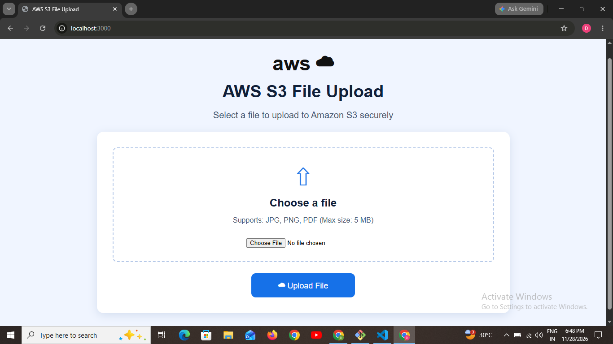

# Secure File Upload System using Node.js and AWS S3

## Project Description

This project is a simple web application that allows users to upload files securely to Amazon S3 using Node.js.

Users can select a file from their computer and upload it to an AWS S3 bucket.

## Technologies Used

- Node.js
- Express.js
- HTML
- CSS
- JavaScript
- AWS S3
- Multer

## Features

- Simple and user-friendly interface
- Upload files to AWS S3
- Secure file storage
- File type validation
- Maximum file size of 5 MB
- Unique file names
- Server-side encryption

## Project Structure

```text
node-s3-upload/
│
├── public/
│   └── index.html
│
├── server.js
├── .env
├── .gitignore
├── package.json
├── package-lock.json
└── README.md
```

## Application UI

Here is the screenshot of the AWS S3 File Upload application.




## Application Preview

The application provides a simple interface where users can:

- Select a file from their computer.
- Upload JPG, PNG and PDF files.
- Upload files securely to AWS S3.
- Receive upload success or error messages.


## Installation

### 1. Clone the repository

```bash
git clone YOUR_GITHUB_REPOSITORY_URL
```

### 2. Open project folder

```bash
cd node-s3-upload
```

### 3. Install dependencies

```bash
npm install
```

### 4. Configure AWS credentials

Create a `.env` file in the project folder.

```env
PORT=3000
AWS_REGION=your-region
S3_BUCKET_NAME=your-bucket-name
AWS_ACCESS_KEY_ID=your-access-key
AWS_SECRET_ACCESS_KEY=your-secret-key
```

Replace the example values with your AWS configuration.

**Never upload the .env file to GitHub.**

### 5. Run the application

```bash
npm start
```

### 6. Open in browser

```text
http://localhost:3000
```

## Upload API

- API Method: POST
- API Endpoint: /upload
- Request Type: multipart/form-data
- File Field Name: file

The application validates the file and uploads it to Amazon S3.

## Supported File Types

- JPG
- PNG
- PDF

Maximum file size: 5 MB.

## AWS S3 Configuration

1. Create an AWS S3 bucket.
2. Keep Block Public Access enabled.
3. Configure IAM permissions.
4. Connect the bucket using environment variables.
5. Upload files through the application.

## Security

- AWS credentials are stored in the `.env` file.
- IAM permissions control S3 access.
- Files are validated before uploading.
- Uploaded files remain private.
- Server-side encryption is enabled.

## Expected Output

After successful upload, the application displays:

File uploaded successfully to AWS S3!

Uploaded files can be checked inside the uploads folder of the S3 bucket.

## Author

Dipali Gaikwad

## Conclusion

This project demonstrates how to build a simple and secure file upload application using Node.js and Amazon S3 cloud storage.
